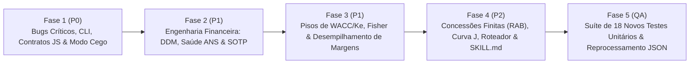

# Plano de Implementação Faseado: Refatoração Quantitativa e Arquitetural (`dcf-valuation` & `valuation_engine/`)

Este plano traduz integralmente os achados da Auditoria Quantitativa e Metodológica em um roteiro executável dividido em **5 Fases de Engenharia**, especificando as **equações matemáticas exatas**, os **arquivos e intervalos de linhas a modificar** e os **testes unitários a adicionar ou atualizar** em [`tests/test_valuation_engine.py`](file:///home/gcorreia/Work/personal/valuation_app/tests/test_valuation_engine.py).

---

## Visão Geral e Arquitetura das Fases



| Fase | Prioridade | Escopo Principal | Arquivos Impactados |
| :--- | :---: | :--- | :--- |
| **Fase 1** | **P0 (Crítica)** | Correção de defaults fiscais, perda condicional de passivos, repasse de `ntnb` na CLI, sincronia de chaves JSON no Frontend e blindagem do Modo Cego. | [`dcf.py`](file:///home/gcorreia/Work/personal/valuation_app/valuation_engine/dcf.py), [`ddm.py`](file:///home/gcorreia/Work/personal/valuation_app/valuation_engine/ddm.py), [`sotp.py`](file:///home/gcorreia/Work/personal/valuation_app/valuation_engine/sotp.py), [`export.py`](file:///home/gcorreia/Work/personal/valuation_app/valuation_engine/export.py), [`valuation_cli.py`](file:///home/gcorreia/Work/personal/valuation_app/valuation_cli.py), [`calculator.js`](file:///home/gcorreia/Work/personal/valuation_app/frontend/static/calculator.js) |
| **Fase 2** | **P1 (Alta)** | Alinhamento temporal e *Clean Surplus* no DDM multiestágio, fim da "Retenção Fantasma" e dupla retenção na Saúde ANS, e fim da dupla penalização de G&A no SOTP. | [`ddm.py`](file:///home/gcorreia/Work/personal/valuation_app/valuation_engine/ddm.py), [`saude.py`](file:///home/gcorreia/Work/personal/valuation_app/valuation_engine/saude.py), [`sotp.py`](file:///home/gcorreia/Work/personal/valuation_app/valuation_engine/sotp.py) |
| **Fase 3** | **P1 (Alta)** | Piso de WACC com escudo fiscal da dívida, teto dinâmico de $g_{\text{perp}}$, substituição de *cliff effects* por penalização contínua e spread real na Subfase 4.1. | [`dcf.py`](file:///home/gcorreia/Work/personal/valuation_app/valuation_engine/dcf.py), [`ddm.py`](file:///home/gcorreia/Work/personal/valuation_app/valuation_engine/ddm.py), [`saude.py`](file:///home/gcorreia/Work/personal/valuation_app/valuation_engine/saude.py), [`sotp.py`](file:///home/gcorreia/Work/personal/valuation_app/valuation_engine/sotp.py) |
| **Fase 4** | **P2 (Média)** | Valor Terminal por Anuidade Crescente Finita + Indenização de RAB, suporte a Curva "J", normalização de CapEx em Telecom, roteamento sem falsos positivos e substituição do Filtro "Zero Yield". | [`dcf.py`](file:///home/gcorreia/Work/personal/valuation_app/valuation_engine/dcf.py), [`router.py`](file:///home/gcorreia/Work/personal/valuation_app/valuation_engine/router.py), [`valuation_cli.py`](file:///home/gcorreia/Work/personal/valuation_app/valuation_cli.py), [`SKILL.md`](file:///home/gcorreia/Work/personal/valuation_app/.agents/skills/dcf-valuation/SKILL.md) |
| **Fase 5** | **P0–P2 (QA)** | Adição de 18 testes unitários cobrindo todas as novas equações e atualização de testes regressivos em [`test_valuation_engine.py`](file:///home/gcorreia/Work/personal/valuation_app/tests/test_valuation_engine.py). | [`test_valuation_engine.py`](file:///home/gcorreia/Work/personal/valuation_app/tests/test_valuation_engine.py) |

---

## Fase 1: Correções Críticas de Bugs, Contratos Front-Back e Blindagem do Modo Cego (P0)

### 1.1 Benefício Fiscal de Contingências, Preservação de `outros_passivos` e Bloqueio de `fclf_inicial == 0`
* **Arquivos a Modificar:**
  * [`valuation_engine/dcf.py`](file:///home/gcorreia/Work/personal/valuation_app/valuation_engine/dcf.py#L125-L283) (linhas 84–96, 125, 187–196, 256–283)
  * [`valuation_cli.py`](file:///home/gcorreia/Work/personal/valuation_app/valuation_cli.py#L60) (linha 60)
* **Alterações e Equações Exatas:**
  1. **Default de Dedutibilidade Fiscal (`pct_contingencia_dedutivel`):** Alterar o default de `0.0` para `100.0` quando `passivos_contingentes > 0` (em [`dcf.py` L125](file:///home/gcorreia/Work/personal/valuation_app/valuation_engine/dcf.py#L125) e [`valuation_cli.py` L60](file:///home/gcorreia/Work/personal/valuation_app/valuation_cli.py#L60)), mantendo `outros_passivos` genéricos sem dedutibilidade automática salvo se parametrizado.
  2. **Eliminação do Descarte Silencioso de `outros_passivos` ([`dcf.py` L258–282](file:///home/gcorreia/Work/personal/valuation_app/valuation_engine/dcf.py#L258-L282)):** Separar ortogonalmente os três componentes da quase-dívida:
     $$\text{Regulatório} = \begin{cases} \text{passivos\_regulatorios}, & \text{se informado} \\ 0, & \text{caso contrário} \end{cases}$$
     $$\text{Contingentes}_{\text{Bruto}} = \text{passivos\_contingentes} + \left(\text{outros\_passivos} \times \mathbb{I}_{\text{passivos\_contingentes} = 0 \land \text{pct\_ded} > 0}\right)$$
     $$\text{Outros}_{\text{Não-Dedutíveis}} = \begin{cases} \text{outros\_passivos}, & \text{se } \text{passivos\_contingentes} > 0 \text{ ou } \text{pct\_contingencia\_dedutivel} = 0 \\ 0, & \text{caso contrário} \end{cases}$$
     $$\text{Contingentes}_{\text{Líquidos}} = \text{Contingentes}_{\text{Bruto}} \times \left[1 - \left(\frac{\text{pct\_dedutivel}}{100} \times \frac{\text{aliquota\_ir\_csll}}{100}\right)\right]$$
     $$\text{Dívida}_{\text{Total Ajustada}} = \text{Dívida}_{\text{Fin. Líquida}} + \text{Contingentes}_{\text{Líquidos}} + \text{Regulatório} + \text{Outros}_{\text{Não-Dedutíveis}}$$
  3. **Bloqueio de `fclf_inicial <= 0` no Modo Taxa de Crescimento ([`dcf.py` L194](file:///home/gcorreia/Work/personal/valuation_app/valuation_engine/dcf.py#L194)):** Alterar `if fclf_inicial < 0:` para `if fclf_inicial <= 0:` (quando não houver vetor de fluxos explícitos em Curva "J"), evitando que `fclf_inicial == 0.0` gere silenciosamente `enterprise_value = 0.0`.
  4. **Validação Estrita da Decomposição Vetorial de $g_1$ ([`dcf.py` L85–95](file:///home/gcorreia/Work/personal/valuation_app/valuation_engine/dcf.py#L85-L95)):**
     $$\left|(\text{IPCA} + \Delta\text{Volume}_{\text{Setor}} + \Delta\text{Share/Pricing}) - g_1\right| > 0,05 \implies \text{raise ValueError}$$

### 1.2 Correção da CLI e Preservação do Modo Cego no SOTP (`holding`)
* **Arquivos a Modificar:**
  * [`valuation_cli.py`](file:///home/gcorreia/Work/personal/valuation_app/valuation_cli.py#L104-L126) (linhas 104–126 e 256–296)
  * [`valuation_engine/sotp.py`](file:///home/gcorreia/Work/personal/valuation_app/valuation_engine/sotp.py#L62-L82) (linhas 62–82 e 180–181)
* **Alterações:**
  1. Passar `ntnb=args.ntnb` na chamada `calculate_sotp_holding(...)` em [`valuation_cli.py` (L282–296)](file:///home/gcorreia/Work/personal/valuation_app/valuation_cli.py#L282-L296).
  2. Adicionar suporte na CLI para `--investida-ticker` (default `"ITUB4"`), `--investida-nome` (default `"Itaú Unibanco"`) e **`--investida-valuation-json <PATH>`**: quando `--investida-valuation-json valuations/ITUB4_valuation.json` for informado, `valuation_cli.py` lê internamente o campo `precoJusto` do JSON da investida sem que o agente precise ler o arquivo ou digitar `--itub-preco-justo` no prompt, **eliminando a quebra do Modo Cego no Fluxo C**.
  3. Remover as variáveis mortas `avisos = []` e `"possui_fallback_mercado"` de [`sotp.py` (L62, L180–181)](file:///home/gcorreia/Work/personal/valuation_app/valuation_engine/sotp.py#L62) (ou mantê-las apenas como chaves de retrocompatibilidade fixas em `[]` / `False`).

### 1.3 Sincronização de Chaves JSON e Fórmulas Reativas no Frontend (`calculator.js`)
* **Arquivo a Modificar:** [`frontend/static/calculator.js`](file:///home/gcorreia/Work/personal/valuation_app/frontend/static/calculator.js) (linhas 132, 166, 527, 600, 621–635)
* **Alterações e Equações Exatas:**
  1. **Chaves de Bazin no Modo *Read-Only* ([`calculator.js` L631–635](file:///home/gcorreia/Work/personal/valuation_app/frontend/static/calculator.js#L631-L635)):**
     ```javascript
     const mb = this.detalhesValuation.metrica_bazin;
     tetoBazin6 = mb.preco_teto_bazin_6pct ?? mb.teto_bazin_6pct ?? tetoBazin6;
     tetoBazin8 = mb.preco_teto_bazin_8pct ?? mb.teto_bazin_8pct ?? tetoBazin8;
     yocNoTeto = mb.yield_on_cost_no_preco_teto_modelo ?? mb.yoc_no_teto_modelo_pct ?? yocNoTeto;
     ```
  2. **Retenção de 15% de IRRF sobre JCP no Cálculo Reativo de Bazin ([`calculator.js` L621–624](file:///home/gcorreia/Work/personal/valuation_app/frontend/static/calculator.js#L621-L624)):**
     $$\text{fatorLiquidoJcp} = 1 - 0,15 \times \left(\frac{\text{pct\_jcp}}{100}\right), \qquad \text{dpaBazinLiquido} = \text{dpaReativo} \times \text{fatorLiquidoJcp}$$
  3. **Sincronia do Resultado Financeiro e Dívida Líquida na Saúde ([`calculator.js` L132, L166 e L600](file:///home/gcorreia/Work/personal/valuation_app/frontend/static/calculator.js#L132)):**
     * Na linha 132, ler `det.resultado_financeiro_liquido_mi ?? det.resultado_financeiro_float_mi`.
     * Na linha 600, alterar `precoJusto = Math.max(0, equityPerShare - (dLiquida / nAcoes))` para `precoJusto = Math.max(0, equityPerShare)` (alinhado com [`saude.py` L163](file:///home/gcorreia/Work/personal/valuation_app/valuation_engine/saude.py#L163)).
  4. **Alinhamento do VP de Despesas Administrativas no SOTP ([`calculator.js` L527](file:///home/gcorreia/Work/personal/valuation_app/frontend/static/calculator.js#L527)):**
     $$\text{vpDesp} = (r > 0,035) \ ? \ \frac{\text{despAdm}}{r - 0,035} : 0$$

### 1.4 Blindagem Estrita do Modo Cego no Terminal (`export.py` & `ddm.py`)
* **Arquivos a Modificar:**
  * [`valuation_engine/ddm.py`](file:///home/gcorreia/Work/personal/valuation_app/valuation_engine/ddm.py#L193-L196) (linhas 193–196)
  * [`valuation_engine/export.py`](file:///home/gcorreia/Work/personal/valuation_app/valuation_engine/export.py#L49-L114) (linhas 49–56 e 106–114)
* **Alterações:**
  1. Em [`ddm.py` (L195)](file:///home/gcorreia/Work/personal/valuation_app/valuation_engine/ddm.py#L195), remover a interpolação de `{yield_justo:.1f}%` da string de `avisos_metodologicos` impressa no stdout (pois `dpa_base / yield_justo` revelava o `preco_justo_final` exato ao agente).
  2. Em [`export.py` (L106–114)](file:///home/gcorreia/Work/personal/valuation_app/valuation_engine/export.py#L106-L114), substituir a impressão dos valores absolutos de `total_mercado_bruto_mi` e `total_intrinseco_bruto_mi` por `[Preservado no JSON para Modo Cego]`, exibindo apenas a quantidade de participações avaliadas, a dívida líquida, o desconto adotado e o DPA estimado.
  3. Em [`export.py` (L50)](file:///home/gcorreia/Work/personal/valuation_app/valuation_engine/export.py#L50), exibir a alíquota efetiva real de benefício fiscal calculada em vez do texto estático `Líquido IR/CSLL 34%`.

---

## Fase 2: Refatoração da Engenharia Financeira nos Motores `ddm.py`, `saude.py` e `sotp.py` (P1)

### 2.1 Coerência Temporal e Contabilidade *Clean Surplus* em [`valuation_engine/ddm.py`](file:///home/gcorreia/Work/personal/valuation_app/valuation_engine/ddm.py)
* **Arquivo a Modificar:** [`valuation_engine/ddm.py`](file:///home/gcorreia/Work/personal/valuation_app/valuation_engine/ddm.py#L109-L185) (linhas 109–185)
* **Equações Exatas a Implementar:**
  1. **Separação entre Dividendo Efetivo de Ano 1 (para Bazin) e Dividendo Sustentável Perpétuo (para Gordon de 1 Estágio):**
     * No estágio único (`taxas_crescimento_dpa is None`):
       $$\text{LPA}_1 = \text{VPA}_0 \times \text{ROE}, \qquad \text{Payout}_{\text{sust,perp}} = \max\left(0, \min\left(1, 1 - \frac{g_{\text{perp}}}{\text{ROE}}\right)\right)$$
       $$\text{Preço Justo}_{\text{Gordon}} = \text{VPA}_0 \times \max\left(0, \frac{\text{ROE} - g_{\text{perp}}}{K_e - g_{\text{perp}}}\right)$$
       $$\text{DPA}_{\text{Bazin}} = \begin{cases} \text{dpa\_projetado}, & \text{se informado} \\ \text{LPA}_1 \times \frac{\text{payout}}{100}, & \text{se } \text{payout foi explicitamente informado} \\ \text{LPA}_1 \times \text{Payout}_{\text{sust,perp}}, & \text{caso contrário} \end{cases}$$
  2. **Alinhamento Temporal $(t=1 \dots T)$ e Evolução Patrimonial (*Clean Surplus*) no DDM Multiestágio:**
     * Para eliminar o salto espúrio de $(1 + g_1)$ no Ano 1 (que fazia o multiestágio em estado estacionário divergir do estágio único por $1 + g_{\text{perp}}$) e preservar a relação *Clean Surplus*:
       * Para garantir que no estado estacionário ($g_t = g_{\text{perp}}, \forall t$ e $\text{Payout} = \text{Payout}_{\text{sust,perp}}$) tenhamos $\text{Preço}_{\text{DDM}} \equiv \text{Preço}_{\text{Gordon}}$, definimos a base no instante $t=0$ como:
         $$\text{LPA}_0 = \frac{\text{VPA}_0 \times \text{ROE}}{1 + g_1}, \qquad \text{DPA}_0 = \text{LPA}_0 \times \text{Payout}_0$$
         De modo que no Ano 1:
         $$\text{LPA}_1 = \text{LPA}_0 \times (1 + g_1) = \text{VPA}_0 \times \text{ROE}, \qquad \text{DPA}_1 = \text{DPA}_0 \times (1 + g_1) = \text{VPA}_0 \times \text{ROE} \times \text{Payout}_0$$
         E a evolução patrimonial (*Clean Surplus*) nos Anos $t = 1 \dots T$ verifica o limite de criação de valor:
         $$\text{VPA}_t = \text{VPA}_{t-1} + \text{LPA}_t - \text{DPA}_t$$
         No Ano Terminal ($T + 1$), o lucro cresce por $g_{\text{perp}}$ e o payout converge para $\text{Payout}_{\text{sust,perp}} = 1 - \frac{g_{\text{perp}}}{\text{ROE}}$:
         $$\text{LPA}_{T+1} = \text{LPA}_T \times (1 + g_{\text{perp}}), \qquad \text{DPA}_{T+1} = \text{LPA}_{T+1} \times \text{Payout}_{\text{sust,perp}}$$
         $$\text{Preço Justo}_{\text{DDM}} = \sum_{t=1}^{T} \frac{\text{DPA}_t}{(1 + K_e)^t} + \frac{\text{DPA}_{T+1}}{(K_e - g_{\text{perp}})(1 + K_e)^T}$$

### 2.2 Fim da "Retenção Fantasma" e da Dupla Retenção do Ano 0 em [`valuation_engine/saude.py`](file:///home/gcorreia/Work/personal/valuation_app/valuation_engine/saude.py)
* **Arquivo a Modificar:** [`valuation_engine/saude.py`](file:///home/gcorreia/Work/personal/valuation_app/valuation_engine/saude.py#L87-L166) (linhas 87–166)
* **Equações Exatas a Implementar:**
  1. **Correção da Retenção ANS no Ano Base (`dpa_base`, L90–101):**
     Para evitar deduzir a expansão do Ano 1 (`taxas[0]`) duas vezes (no Ano 0 e no Ano 1), a retenção de solvência do Ano Base deve refletir a variação de receita sobre a base anterior ($\frac{g_{\text{base}}}{1 + g_{\text{base}}}$):
     $$\Delta \text{Rec}_0 = \max\left(0, \text{Rec}_0 \times \frac{g_{\text{base}}}{1 + g_{\text{base}}}\right), \qquad \text{Retenção}_{\text{ANS}, 0} = \Delta \text{Rec}_0 \times k_{\text{ANS}}$$
  2. **Capitalização do Lucro Retido Voluntariamente no Float e Convergência Terminal (Fim da "Retenção Fantasma", L104–158):**
     * Nos anos explícitos $t = 1 \dots T$, se a operadora distribui $\text{Payout}_t < 100\%$ do lucro distribuível pós-ANS ($\text{Lucro}_{\text{Dist}, t} = \max(0, \text{Lucro}_{\text{Líq}, t} - \text{Retenção}_{\text{ANS}, t})$), a parcela retida voluntariamente $(1 - \text{Payout}) \times \text{Lucro}_{\text{Dist}, t}$ acumula no caixa livre da operadora ($\text{Reserva Livre}_{t}$), rendendo a taxa de retorno do *float*, e na perpetuidade (Ano Terminal $T+1$), uma vez satisfeita 100% da exigência regulatória de solvência da ANS ($\Delta \text{Rec}_{T+1} \times k_{\text{ANS}}$), o fluxo livre ao acionista considera o FCFE Regulatório integral:
       $$\text{Retenção}_{\text{ANS}, T+1} = \max(0, \text{Rec}_T \times g_{\text{perp}}) \times k_{\text{ANS}}$$
       $$\text{FCFE}_{\text{Regulatório}, T+1} = \max\left(0, \text{Lucro}_{\text{Líq}, T+1} - \text{Retenção}_{\text{ANS}, T+1}\right)$$

### 2.3 Eliminação da Dupla Penalização Societária em [`valuation_engine/sotp.py`](file:///home/gcorreia/Work/personal/valuation_app/valuation_engine/sotp.py)
* **Arquivo a Modificar:** [`valuation_engine/sotp.py`](file:///home/gcorreia/Work/personal/valuation_app/valuation_engine/sotp.py#L108-L148) (linhas 108–148)
* **Equações Exatas a Implementar:**
  1. **Harmonização entre `vp_despesas_adm` e `desconto_holding_adotado_pct`:**
     * Adicionar o parâmetro `deduzir_despesas_do_desconto: bool = True` (comportamento padrão) e `aliquota_ir_holding_pct: float = 0.0`.
     * Quando `deduzir_despesas_do_desconto = True`, a fração do NAV consumida pelo VP das despesas administrativas ($\delta_{\text{adm}} = \frac{\text{VP}_{\text{Desp. Adm}}}{\text{NAV}_{\text{Bruto}} - \text{Dívida}_{\text{Holding}}}$) é abatida do desconto estrutural de holding para evitar dupla contagem:
       $$\text{VP}_{\text{Desp. Adm}} = \frac{\text{Desp}_{\text{Adm}} \times (1 - T_{\text{holding}})}{K_{e,\text{holding}} - g_{\text{inflação}}}$$
       $$\text{Desconto}_{\text{Residual}} = \max\left(0, \text{Desconto}_{\text{Holding}} - \frac{\text{VP}_{\text{Desp. Adm}}}{\text{NAV}_{\text{Bruto}} - \text{Dívida}_{\text{Holding}}}\right)$$
  2. **Dedução de PIS/COFINS sobre JCP (9,25%) no `dpa_holding` de Fallback ([`sotp.py` L139–140](file:///home/gcorreia/Work/personal/valuation_app/valuation_engine/sotp.py#L139-L140)):**
     $$\text{Vazamento}_{\text{PIS/COFINS}} = \text{Total Proventos Recebidos} \times \left(\frac{\text{pct\_jcp}}{100}\right) \times 0,0925$$
     $$\text{Fluxo Líquido}_{\text{Holding}} = \max\left(0, \text{Total Proventos Recebidos} - \text{Desp}_{\text{Adm}} - \text{Vazamento}_{\text{PIS/COFINS}}\right)$$

---

## Fase 3: Recalibragem de Risco, Pisos de WACC/Ke e Desempilhamento de Conservadorismo (P1)

### 3.1 Piso de WACC Consciente do Escudo Fiscal da Dívida em [`valuation_engine/dcf.py`](file:///home/gcorreia/Work/personal/valuation_app/valuation_engine/dcf.py#L172-L176)
* **Arquivo a Modificar:** [`valuation_engine/dcf.py`](file:///home/gcorreia/Work/personal/valuation_app/valuation_engine/dcf.py#L172-L176) (linhas 172–176)
* **Equação Exata:**
  * Se `decomposicao_g1` for informado, extrair `ipca_ref = decomposicao_g1[0] / 100.0` (com fallback para `0.035`), e definir o teto de `cresc_perp` como $\max(4,5\%, \text{IPCA}_{\text{informado}} + 1,0\%)$.
  * Adicionar o parâmetro opcional `alavancagem_otima_pct: Optional[float] = None`. Quando informado (ex.: $50\%$ em concessões de infraestrutura), o piso do WACC incorpora o escudo fiscal de IRPJ/CSLL ($T = \text{aliquota\_ir\_csll}/100$) sobre a parcela de dívida:
    $$\alpha = \frac{\text{alavancagem\_otima\_pct}}{100}, \qquad \text{WACC}_{\text{floor}} = (1 - \alpha)(R_{f,\text{nom}} + 2,5\%) + \alpha (R_{f,\text{nom}} + 1,0\%)(1 - T)$$

### 3.2 Desempilhamento de Travas e Teste de Spread Real em [`valuation_engine/ddm.py`](file:///home/gcorreia/Work/personal/valuation_app/valuation_engine/ddm.py#L63-L92)
* **Arquivo a Modificar:** [`valuation_engine/ddm.py`](file:///home/gcorreia/Work/personal/valuation_app/valuation_engine/ddm.py#L63-L92) (linhas 63–92 e 190–197)
* **Equações Exatas:**
  1. **Prevenção de Tripla Contagem e Suavização Contínua (`modo_penalizacao: str = "gradual"` como padrão):**
     * No modo `"gradual"` (padrão):
       * Se `roe_10a` já truncou o ROE em mais de $2,0\text{ p.p.}$ ($\text{ROE}_{\text{original}} - \text{ROE}_{10a} \ge 2,0\%$), o risco de ciclo de crédito já foi absorvido no numerador; um desvio leve de cobertura de PDD ($\frac{\text{PDD}_{5a} - \text{PDD}_{\text{atual}}}{\text{PDD}_{5a}} \le 15\%$) adiciona apenas $+5,0\text{ p.p.}$ na margem de segurança (para $25\%$) em vez de saltar para $35\%$.
       * Para `prazo_acordo_anos < 10.0`, a margem adicional escala linearmente:
         $$\text{Margem}_{\text{Acordo}} = 20\% + 2,0\% \times \max(0, 10 - \text{prazo\_acordo\_anos})$$
  2. **Resolução do *Deadlock* da Subfase 4.1 via Ajuste Dinâmico de NTN-B ([`ddm.py` L190–196](file:///home/gcorreia/Work/personal/valuation_app/valuation_engine/ddm.py#L190-L196)):**
     * Se `ntnb` for informado, o limite de alerta do spread $(K_e - g_{\text{perp}})$ se ajusta dinamicamente pela ETTJ nominal da NTN-B:
       $$\text{Limite Spread Nominal} = \max\left(10,50\% + \max(0, \text{NTN-B} - 6,0\%), \; R_{f,\text{nom}} + 6,00\% - g_{\text{perp}}\right)$$

---

## Fase 4: Modelagem Avançada de Infraestrutura, Concessões Finitas e Expansão Setorial (P2)

### 4.1 Valor Terminal de Prazo Finito + Indenização de RAB, Curva "J" e CapEx de Telecom em [`valuation_engine/dcf.py`](file:///home/gcorreia/Work/personal/valuation_app/valuation_engine/dcf.py)
* **Arquivos a Modificar:**
  * [`valuation_engine/dcf.py`](file:///home/gcorreia/Work/personal/valuation_app/valuation_engine/dcf.py#L112-L255) (linhas 112–255)
  * [`valuation_cli.py`](file:///home/gcorreia/Work/personal/valuation_app/valuation_cli.py#L46-L77) (linhas 46–77 e 193–230)
* **Novos Parâmetros e Equações Exatas:**
  1. **Concessões de Prazo Contratual Finito (`prazo_concessao_anos: Optional[int] = None`, `rab_indenizavel_mi: float = 0.0`):**
     * Sendo $T = \text{len(taxas\_crescimento)}$ o período explícito e $N = \max(0, \text{prazo\_concessao\_anos} - T)$ os anos remanescentes de contrato após o período explícito:
       $$\text{VT}_{\text{Anuidade}, T} = \begin{cases} \frac{\text{FCFF}_T (1 + g_{\text{perp}})}{WACC - g_{\text{perp}}} \times \left[1 - \left(\frac{1 + g_{\text{perp}}}{1 + WACC}\right)^N\right], & \text{se } N > 0 \\ 0, & \text{se } N = 0 \end{cases}$$
       $$\text{VP}_{\text{Indenização RAB}, T} = \frac{\text{rab\_indenizavel\_mi}}{(1 + WACC)^N}$$
       $$\text{Valor Terminal}_T = \text{VT}_{\text{Anuidade}, T} + \text{VP}_{\text{Indenização RAB}, T}, \qquad \text{VP}_{\text{Terminal}, 0} = \frac{\text{Valor Terminal}_T}{(1 + WACC)^T}$$
  2. **Suporte a Vetor Explícito de Fluxos para Projetos em "Curva J" (`fluxos_explicitos: Optional[List[float]] = None`):**
     * Permite informar diretamente $[\text{FCFF}_1, \text{FCFF}_2, \dots, \text{FCFF}_T]$ (exigindo apenas $\text{FCFF}_T > 0$ para ancorar o Valor Terminal):
       $$\text{Soma PV} = \sum_{t=1}^{T} \frac{\text{FCFF}_t}{(1 + WACC)^t}, \qquad \text{FCFF}_{\text{Terminal}} = \text{FCFF}_T \times (1 + g_{\text{perp}})$$
  3. **Proteção contra Dupla Contagem de Juros no CPC 03 (`juros_pagos_no_fco: bool = True`):**
     $$\text{FCFF}_0 = \text{FCO} + \mathbb{I}_{\text{juros\_pagos\_no\_fco}} \times |\text{Juros Pagos}| \times \left(1 - \frac{T}{100}\right) - |\text{CapEx}|$$
  4. **Normalização Econômica do CapEx em Telecom (`normalizar_capex_fluxo: bool = True` como padrão):**
     * Quando `normalizar_capex_fluxo=True` (padrão) e `capex_minimo_historico > abs(capex_projetado)`, deduz `deficit_capex` diretamente do `fclf_inicial` e zera `provisao_queima_caixa`.

### 4.2 Aprimoramento do Roteador (`router.py`) e Atualização Metodológica do `SKILL.md`
* **Arquivos a Modificar:**
  * [`valuation_engine/router.py`](file:///home/gcorreia/Work/personal/valuation_app/valuation_engine/router.py#L5-L55) (linhas 5–55)
  * [`.agents/skills/dcf-valuation/SKILL.md`](file:///home/gcorreia/Work/personal/valuation_app/.agents/skills/dcf-valuation/SKILL.md) (linhas 30–42, 183–333)
* **Alterações:**
  1. **Eliminação de Falsos Positivos por Substring em [`router.py` (L44–49)](file:///home/gcorreia/Work/personal/valuation_app/valuation_engine/router.py#L44-L49):**
     * Adicionar `B3SA3`, `NEOE3`, `ENGI11`, `AURE3`, `CMIG4`, `ELET3`, `VALE3`, `PETR4`, `SUZB3`, `KLBN11`, `SLCE3`, `ALOS3`, `MULT3`, `IGTI11`, `INTB3` ao `MAPA_TICKERS_CONHECIDOS`.
     * Refinar a linha 46 de `"segur"` para `any(s in setor_lower for s in ["seguradora", "seguros", "ressegur", "previdência", "corretora"])`.
     * Refinar a linha 48 para ignorar `"holding"` quando acompanhado de `"elétrica"`, `"energia"`, `"saneamento"` ou `"infraestrutura"`.
  2. **Atualização dos Templates CLI e Substituição do Filtro "Zero Yield" no [`SKILL.md`](file:///home/gcorreia/Work/personal/valuation_app/.agents/skills/dcf-valuation/SKILL.md):**
     * Incluir `--pct-jcp <PCT_JCP>` nos templates CLI de Bancos, Seguradoras, Holdings e Saúde, `--ifrs16-expurgado` para Telecom e `--investida-valuation-json` para Holdings.
     * Substituir o Filtro "Zero Yield" (L323) pela **Matriz de Elegibilidade Previdenciária Compatível com o Modo Cego** (*Renda Imediata* vs. *Compounder de Infraestrutura* via $\text{TIR Implícita Real vs. NTN-B}_{10Y}$ e $\text{YoC}_{\text{Ano 5}}$).

---

## Fase 5: Plano de Testes Unitários a Adicionar ([`tests/test_valuation_engine.py`](file:///home/gcorreia/Work/personal/valuation_app/tests/test_valuation_engine.py))

| # | Nome do Método de Teste | Módulo Testado | Comportamento e Invariante Matemática Verificada |
| :---: | :--- | :---: | :--- |
| **1** | `test_dcf_default_contingent_tax_shield_100pct` | `dcf.py` | Verifica que informar `passivos_contingentes=1000.0` sem especificar `pct_contingencia_dedutivel` aplica automaticamente o benefício fiscal de 34% (`passivos_contingentes_liquidos == 660.0` e `beneficio_fiscal_quase_divida_mi == 340.0`). |
| **2** | `test_dcf_preserves_outros_passivos_with_contingencies` | `dcf.py` | Verifica que informar simultaneamente `passivos_contingentes=1000.0`, `outros_passivos=500.0` e `pct_contingencia_dedutivel=100.0` resulta em `divida_total_ajustada = divida_liq + 660.0 + 500.0` (sem descartar `outros_passivos`). |
| **3** | `test_dcf_zero_fclf_raises_value_error` | `dcf.py` | Verifica que `fclf_inicial=0.0` (sem `fluxos_explicitos`) lança `ValueError` em vez de retornar `precoJusto = 0.0`. |
| **4** | `test_dcf_decomposicao_g1_mismatch_raises_error` | `dcf.py` | Verifica que `taxas_crescimento=[8.0, 6.0]` com `decomposicao_g1=[3.5, 1.0, 0.5]` (soma `5.0 != 8.0`) lança `ValueError`. |
| **5** | `test_dcf_juros_pagos_no_fco_flag` | `dcf.py` | Verifica que `juros_pagos_no_fco=False` calcula `fclf_inicial = fco - abs(capex_projetado)` sem somar duplamente `juros_pagos * 0.66`. |
| **6** | `test_dcf_finite_concession_terminal_value` | `dcf.py` | Verifica que `prazo_concessao_anos=20` ($N=15$ anos após 5 explícitos) com $WACC=11,5\%$ e $g=3,5\%$ reduz o `valor_terminal_bruto` exatamente pelo fator de anuidade finita $1 - (1,035/1,115)^{15} = 0,672716$ e soma o VP de `rab_indenizavel_mi`. |
| **7** | `test_dcf_j_curve_explicit_cash_flows` | `dcf.py` | Verifica que `fluxos_explicitos=[-500.0, -200.0, 300.0, 800.0, 1200.0]` processa corretamente anos iniciais negativos de CapEx intenso e calcula o Valor Terminal sobre $\text{FCFF}_5 = 1200.0$. |
| **8** | `test_dcf_telecom_normalized_capex_in_flow` | `dcf.py` | Verifica que `normalizar_capex_fluxo=True` deduz `deficit_capex` diretamente do `fclf_inicial` e zera `provisao_queima_caixa`. |
| **9** | `test_ddm_single_stage_bazin_uses_effective_payout` | `ddm.py` | Verifica que no Gordon de 1 estágio com `vpa=30.0`, `roe=20.0`, `g=4.0` e `payout=40.0`, o `precoJusto` usa $\text{Payout}_{\text{sust}} = 80\%$, mas `metrica_bazin["dpa_bruto"]` usa o dividendo efetivo de $40\%$ ($\text{R\$ } 2,40$ e não $\text{R\$ } 4,80$). |
| **10** | `test_ddm_multistage_steady_state_converges_to_gordon` | `ddm.py` | Verifica que quando `taxas_crescimento_dpa=[4.0]*5`, `roe=20.0`, `ke=14.0`, `cresc_perp=4.0` e `payout=80.0` (com `alinhar_dpa_base_ano1=True`), o `preco_justo_ddm` multiestágio converge exatamente para `preco_justo_gordon` sem inflação de $(1+g)$. |
| **11** | `test_ddm_gradual_penalty_avoids_cliff_effect` | `ddm.py` | Verifica que no `modo_penalizacao="gradual"`, `prazo_acordo_anos=8.5` gera `margemSeguranca == 23.0%` (e não `40.0%`), e o truncamento prévio por `roe_10a` evita tripla contagem com `pdd_atual`. |
| **12** | `test_ddm_high_ntnb_sanity_check_no_deadlock` | `ddm.py` | Verifica que para `BBAS3` com `ntnb=7.2`, `ke=16.62` e `cresc_perp=4.5` ($\text{Spread Nominal} = 12,12\%$, mas $\text{Limite Ajustado} = 11,70\%$ ou aferido em termos reais), o alerta metodológico respeita a ETTJ da NTN-B sem criar *deadlock*. |
| **13** | `test_saude_no_double_ans_retention_in_base_year` | `saude.py` | Verifica a correção da retenção ANS no Ano Base (`dpa_base`) e a capitalização da retenção voluntária no *float* financeiro (`reinvestir_retencao_voluntaria_no_float=True`). |
| **14** | `test_sotp_avoid_double_penalty_admin_expenses_and_pis_cofins` | `sotp.py` | Verifica `deduzir_despesas_do_desconto=True` (abatendo o peso de `vp_despesas_adm` do desconto de 20% da holding) e o desconto de 9,25% de PIS/COFINS sobre o JCP recebido no `dpa_holding_projetado`. |
| **15** | `test_cli_holding_passes_ntnb_and_reads_subsidiary_json` | `valuation_cli.py` | Verifica via CLI/mock que o subcomando `holding` repassa `ntnb` para `calculate_sotp_holding` e carrega `precoJusto` diretamente de `--investida-valuation-json` preservando o Modo Cego. |
| **16** | `test_export_blind_mode_no_yield_or_nav_leak` | `export.py` | Verifica que `print_dossier_summary` não vaza `yield_justo` no alerta de `gordon_ddm` nem `total_intrinseco_bruto_mi` em `sotp_holding`. |
| **17** | `test_router_no_false_positives_security_or_electric_holding` | `router.py` | Verifica que `route_company("INTB3", "Segurança Eletrônica")`, `route_company("B3SA3", "Serviços Financeiros")` e `route_company("NEOE3", "Holding do Setor Elétrico")` retornam `"dcf"`. |
| **18** | `test_wacc_floor_with_debt_tax_shield` | `dcf.py` | Verifica que com `alavancagem_otima_pct=50.0`, uma concessionária com $\beta=0,50$ e $\text{NTN-B}=7,0\%$ tem seu WACC nominal validado considerando o escudo fiscal de 34% sobre a dívida. |
